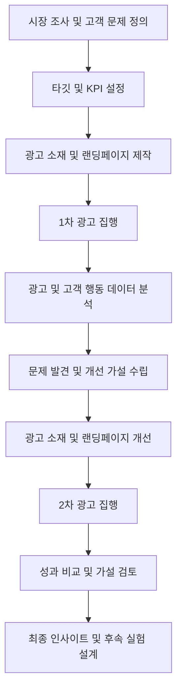
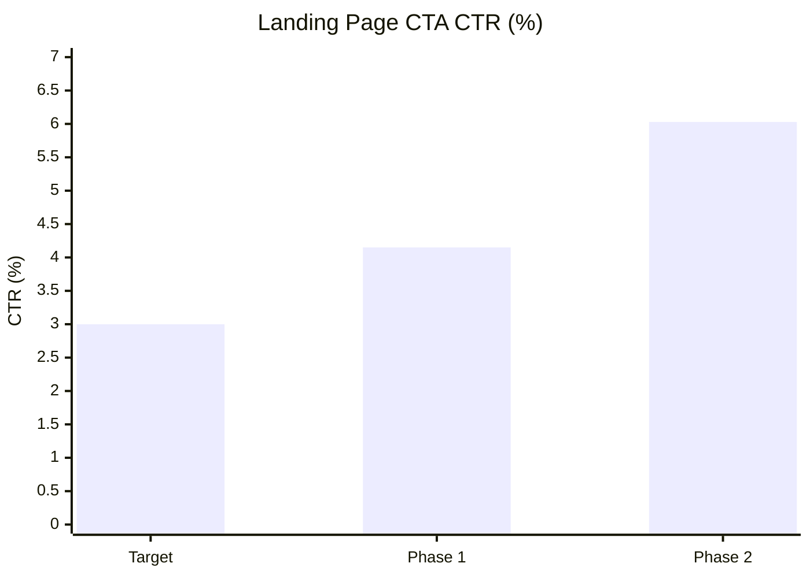

# 🔥 Fire.up | 미국 ETF 교육 홍보 프로젝트

> **99%의 클릭, 고객의 고민에서 답을 찾다.**

[Instagram 공식 계정](https://www.instagram.com/fire.up_official/)
[랜딩페이지](https://fireclub-etf.vercel.app/)
[PPT]()

---

## 👥 15. Team Fire.up

| 담당 분야 | 팀원 | 담당 분야 | 팀원 |
|---|---|---|---|
| 퍼포먼스 | 윤하영 (팀장) | 캠페인(AE) | 이성아 |
| 그로스 | 이성일 | 콘텐츠 | 정지원 |
| CRM | 김진영 | 브랜드 | 이재석 |

## 📌 1. 프로젝트 개요

Fire.up(파이어업)은 미국 ETF 투자 교육 강의를 홍보하기 위해
기획한 데이터 기반 그로스 마케팅 프로젝트입니다.

고객의 투자 고민을 중심으로 광고 소재를 제작하고,
실제 광고 집행 및 고객 행동 데이터 분석을 통해
랜딩페이지의 전환 구조와 광고 운영 전략을 개선했습니다.

단순한 트래픽 확보를 넘어 고객의 유입부터 CTA 클릭까지
전체 퍼널을 분석하고, 데이터 기반의 개선을 통해
마케팅 성과를 높이는 것을 목표로 진행했습니다.

| 구분 | 내용 |
|---|---|
| 프로젝트명 | Fire.up (파이어업) |
| 프로젝트 기간 | 2026.10.26 ~ 2026.11.17 |
| 광고 집행 기간 | 2026.11.06 ~ 2026.11.13 |
| 프로젝트 유형 | 그로스 마케팅 팀 프로젝트 |
| 참여 인원 | 6명 |
| 홍보 상품 | 포메뽀꼬의 미국 ETF 투자법 |
| 광고 예산 | 399,300원 (VAT 포함 계획 예산) |
| 핵심 목표 | 랜딩페이지 CTA 클릭률 개선 |
| 담당 역할 | 광고 집행, 데이터 분석, 인사이트 도출, 개선안 수립 |

<!-- 실제 랜딩페이지 URL을 입력해주세요.
[🔗 프로젝트 웹사이트 바로가기](URL)
-->

---

## 🏆 2. 핵심 성과

### 주요 성과 요약

| 핵심 지표 | 최종 성과 |
|---|---:|
| 랜딩페이지 CTA 클릭률 | **4.87%** |
| 랜딩페이지 개선 후 CTA 클릭률 | **6.03%** |
| 전체 랜딩 방문 세션 | **1,952회** |
| 전체 CTA 클릭 | **95회** |
| Meta 광고 노출 | **46,754회** |
| Meta 광고 링크 클릭 | **2,413회** |
| Meta 광고 평균 CTR | **5.16%** |
| Instagram 콘텐츠 조회수 | **19,935회** |

### 목표 KPI 달성 현황

| 지표 | 목표 | 결과 | 달성률 |
|---|---:|---:|---:|
| 북극성 지표 : 랜딩 CTA CTR | 3.0% | 4.87% | 162.3% |
| 랜딩 방문 세션 | 850회 | 1,952회 | 229.6% |
| 광고 유입 CTA CVR | 3.0% | 3.22% | 107.3% |

**설정한 핵심 KPI 3개 모두 목표 달성**

### 주요 개선 성과

- 랜딩페이지 CTA 클릭률 : 4.15% → 6.03%
- 랜딩페이지 CTA 클릭률 상대 개선율 : **45.3%**
- Meta 광고 CPC : 108원 → 89원
- Meta 광고 클릭당 비용 : **17.6% 절감**
- 1차 Meta 광고 클릭의 **99%**가 고객 고민형 소재에 집중
- 2차 신규 광고 소재 클릭의 **97%**가 노후 고민형 소재에 집중

---

## 🎯 3. 프로젝트 기획 배경

### 시장 및 고객 문제 정의

개인 투자자와 ETF 시장의 성장에 따라 투자 교육에 대한
수요도 증가하고 있습니다.

그러나 ETF 투자를 이미 시작한 고객 중에서도
명확한 투자 기준 없이 투자하거나,
현재의 투자 방식이 장기적인 노후 준비에 적합한지
확신하지 못하는 고객이 존재한다고 판단했습니다.

이에 단순한 투자 정보 전달이 아닌,
고객 스스로 투자 기준을 세울 수 있도록 돕는
교육의 가치를 중심으로 캠페인을 기획했습니다.

### 핵심 타깃

| 항목 | 내용 |
|---|---|
| 연령 | 35~44세 |
| 직업 | 직장인 |
| 투자 경험 | ETF 투자 입문자 |
| 주요 관심사 | 노후 준비, 장기 투자, 자산관리 |
| 정보 탐색 채널 | Instagram, Google, YouTube |
| Pain Point | ETF 투자는 시작했지만 명확한 투자 기준이 부족함 |
| Needs | ETF 선택 기준 및 장기적인 자산관리 전략 |

### 핵심 USP

> ETF 이해부터 노후 준비까지,
> 나만의 투자 기준을 세우는 교육

### 캠페인 메시지

> 감으로 투자하지 말고, 이해하고 투자하세요.

---

## 🛠️ 4. 활용 도구

| 분류 | 활용 도구 | 활용 목적 |
|---|---|---|
| 퍼포먼스 마케팅 | Meta Ads | 광고 집행 및 소재별 성과 분석 |
| 검색광고 | Google Ads | 검색광고 운영 및 최적화 |
| 키워드 리서치 | Google Keyword Planner | 검색량, 입찰가, 검색 의도 분석 |
| 데이터 분석 | Google Analytics 4 | 유입 경로 및 고객 행동 분석 |
| 이벤트 측정 | Google Tag Manager | CTA 및 사용자 행동 이벤트 측정 |
| 유입 추적 | UTM Parameter | 채널 및 소재별 유입 성과 구분 |
| 바이럴 마케팅 | Instagram, Threads | 브랜드 콘텐츠 확산 |
| 오가닉 마케팅 | Naver Blog, Blind | 정보성 콘텐츠 및 추가 유입 확보 |

---

## 👨‍💻 5. 담당 역할 및 개인 기여

### Performance Marketing & Data Analytics

광고 집행부터 고객 행동 분석, 문제 정의,
개선안 수립까지 데이터 기반의 의사결정 과정에 참여했습니다.

#### ① 광고 집행 및 운영

- Meta 및 Google 광고 운영
- 광고 매체별 미디어믹스 수립
- 광고 소재별 CTR, CPC, 노출, 클릭 성과 분석
- Google 검색광고 키워드 리서치
- 실제 검색어 보고서 분석 및 제외 키워드 설정
- 1차 광고 성과 기반 2차 운영 전략 수립

#### ② 데이터 분석

- GA4 기반 채널별 유입 성과 분석
- UTM 기반 광고 소재별 성과 비교
- 랜딩페이지 고객 행동 및 이탈 구간 분석
- CTA 클릭률 및 전환 퍼널 분석
- 1·2차 캠페인 성과 비교
- 핵심 KPI 달성 여부 검토

#### ③ 인사이트 도출

- 고객 고민형 광고 소재의 높은 클릭 반응 발견
- 광고 메시지와 랜딩페이지 메시지 간 불일치 가설 수립
- 랜딩페이지 내 주요 이탈 구간 파악
- 검색광고의 비효율적인 검색어 및 비용 지출 확인
- 채널별 비용 효율 차이 분석
- 미니게임 참여율 및 CTA 전환 가능성 분석

#### ④ 개선안 수립

- 광고와 랜딩페이지 메시지 일관성 강화
- 고객 공감 중심의 랜딩페이지 구조 개선 제안
- CTA 문구 및 배치 개선
- 고성과 광고 소재 유지 및 신규 소재 확장
- 검색 의도 기반 키워드 재설계
- 후속 캠페인 실험 및 예산 재배분 전략 수립

---

## 🔄 6. 프로젝트 진행 프로세스

### 캠페인 일정

| 단계 | 주요 활동 |
|---|---|
| 기획 | 시장 조사, 페르소나, USP, KPI 설정 |
| 제작 | 브랜드 IP, 광고 소재, 랜딩페이지 제작 |
| 1차 집행 | 11.06 ~ 11.10 |
| 분석 및 개선 | 광고 성과 분석, 퍼널 분석, 개선안 적용 |
| 2차 집행 | 11.10 ~ 11.13 |
| 최종 분석 | 성과 비교, 인사이트 및 후속 전략 수립 |

---

## 📈 7. 데이터 기반 문제 해결 과정

### Case 01. 고객 고민형 광고 소재 발굴

#### Problem

브랜드 및 강의 소개 중심의 광고가
고객의 구체적인 투자 고민과 충분히 연결되지 않았습니다.

#### Data

1차 Meta 광고 집행 결과, 전체 링크 클릭 1,142회 중
1,132회가 하나의 광고 소재에 집중되었습니다.

| 지표 | 대화형 캐러셀 소재 |
|---|---:|
| 핵심 카피 | ETF만 사면 노후 끝? |
| 노출 | 22,230회 |
| 링크 클릭 | 1,132회 |
| CTR | 5.09% |
| CPC | 106원 |
| 전체 클릭 비중 | 약 99% |

#### Insight

브랜드나 강의를 소개하는 메시지보다
고객이 실제로 가지고 있는 노후 준비에 대한 고민을
직접적으로 자극하는 메시지가 높은 클릭 반응을 보였습니다.

#### Action

- 기존 고성과 광고 소재 유지
- 노후 준비 키워드를 활용한 신규 소재 3종 제작
- 질문형 카피 및 고객 공감 메시지 강화
- 브랜드 캐릭터를 활용한 메시지 일관성 유지

#### Result

2차 신규 광고 소재의 전체 클릭 594회 중
579회가 노후 고민형 단일 이미지 소재에 집중되었습니다.

| 지표 | 2차 신규 고성과 소재 |
|---|---:|
| 링크 클릭 | 579회 |
| CTR | 5.20% |
| CPC | 98원 |
| 신규 소재 클릭 비중 | 약 97% |

단, Meta의 자동 최적화로 특정 소재에 노출이 집중되었으므로
메시지와 캐릭터의 독립적인 효과를 확인하기 위해서는
추가적인 통제 실험이 필요합니다.

---

### Case 02. 랜딩페이지 전환 퍼널 개선

#### Problem

광고에서는 높은 클릭 반응을 확보했지만,
해당 광고를 통해 유입된 고객의 랜딩페이지 CTA 클릭률은
상대적으로 낮게 나타났습니다.

#### Data

| 지표 | 1차 성과 |
|---|---:|
| 고성과 광고 소재 CTR | 5.09% |
| 해당 소재 유입 고객의 랜딩 CTA 클릭률 | 1.93% |
| 전체 랜딩 CTA 클릭률 | 4.15% |
| 첫 화면 이후 강의 소개 구간까지 누적 이탈률 | 74.67% |

#### Hypothesis

광고를 통해 형성된 고객의 기대와
랜딩페이지에서 전달하는 메시지 사이의 불일치가
초반 이탈에 영향을 주었을 가능성이 있다고 판단했습니다.

**광고 메시지**

> ETF만 사면 노후 끝?

**기존 랜딩페이지 메시지**

> 감으로 투자하지 말고, 이해하고 투자하세요.

광고는 노후 준비라는 구체적인 고민을 자극했지만,
랜딩페이지는 투자 이해라는 보다 포괄적인 메시지로
시작하고 있었습니다.

#### Action

| 개선 영역 | Before | After |
|---|---|---|
| 첫 화면 | 투자 이해 중심 | 노후 고민 중심 |
| 고객 공감 | 강사 저서 소개 | 고객 고민 말풍선 |
| 학습 필요성 | 강사 소개 중심 | 투자 자가 점검 체크리스트 |
| CTA 문구 | 강의 살펴보기 | ETF 학습 가치 중심 |
| CTA 배치 | 2개 위치 | 6개 위치 |
| 추가 탐색 | FAQ 중심 | 블로그 콘텐츠 추가 |

#### Result

| 지표 | 1차 | 2차 |
|---|---:|---:|
| 랜딩 유입 | 1,206회 | 746회 |
| CTA 클릭 | 50회 | 45회 |
| CTA 클릭률 | 4.15% | 6.03% |

- CTA 클릭률 1.88%p 상승
- 기존 대비 상대 개선율 45.3%

> 고객의 유입 동기와 랜딩페이지의 메시지를 연결하고,
> 고객이 학습의 필요성을 인식하도록 전환 구조를 개선했습니다.

다만 광고 소재, 유입 구성, 집행 기간이 함께 변경되었으므로
랜딩페이지 개선만의 인과적 효과로 단정할 수 없습니다.

---

### Case 03. Google 검색광고 비용 효율 분석

#### Problem

제한된 광고 예산에서 확장검색으로 인해
홍보 상품과 직접적인 관련성이 낮은 검색어에도
광고 비용이 발생했습니다.

#### Data

| 항목 | 결과 |
|---|---:|
| 1차 Google 광고 집행 비용 | 35,953원 |
| 타 강사명 관련 검색어 비용 | 8,569원 |
| 해당 검색어 클릭 | 2회 |
| 전체 비용 대비 비중 | 약 24% |

#### Action

- 실제 검색어 보고서 분석
- 관련성이 낮은 강사명 제외 키워드 등록
- 광고 제목 및 설명 문안 개선
- 강의 탐색형에서 ETF 상품 탐색형으로 키워드 확장
- 검색 의도와 강의 관련성을 고려한 키워드 재설계

#### Result

| 지표 | 1차 | 2차 |
|---|---:|---:|
| CTR | 2.15% | 3.10% |
| CPC | 1,198원 | 2,473원 |
| 클릭 | 30회 | 27회 |
| 노출 | 1,397회 | 872회 |

CTR은 상승했지만 CPC 역시 크게 증가했습니다.

검색광고에서 클릭률 개선이 반드시
비용 효율 개선으로 이어지는 것은 아니라는 점을 확인했습니다.

#### Next Action

- Google 검색광고 예산 축소 또는 제외 검토
- Meta 중심의 미디어믹스 재설계
- 검색 의도별 전환 성과 추가 검증
- 클릭당 비용이 아닌 전환당 비용 중심의 예산 배분

---

## 💰 8. 광고 미디어믹스

### 계획 예산

| 매체 | 1차 | 2차 | 합계 |
|---|---:|---:|---:|
| Meta Ads | 143,880원 | 128,205원 | 272,085원 |
| Google Ads | 35,970원 | 54,945원 | 90,915원 |
| 합계 | 179,850원 | 183,150원 | 363,000원 |

- VAT 제외 광고 배분 예산 : 363,000원
- VAT 포함 총예산 : 399,300원
- 실제 소진액이 아닌 계획 예산 기준

### 운영 전략

**1차 캠페인**

- Meta : 80%
- Google : 20%
- 다양한 광고 소재 및 메시지 반응 탐색

**2차 캠페인**

- 기존 고성과 Meta 소재 : 35%
- 신규 Meta 소재 : 35%
- Google 검색광고 : 30%
- 고성과 메시지 확장 및 검색 의도 검증

---

## 📊 9. 1·2차 캠페인 성과 비교

### Meta Ads

| 지표 | 1차 | 2차 | 변화 |
|---|---:|---:|---:|
| 노출 | 22,601 | 24,153 | +6.9% |
| 링크 클릭 | 1,142 | 1,271 | +11.3% |
| CTR | 5.05% | 5.26% | +0.21%p |
| CPC | 108원 | 89원 | -17.6% |

### Google Ads

| 지표 | 1차 | 2차 | 변화 |
|---|---:|---:|---:|
| 노출 | 1,397 | 872 | -37.6% |
| 클릭 | 30 | 27 | -10.0% |
| CTR | 2.15% | 3.10% | +0.95%p |
| CPC | 1,198원 | 2,473원 | +106.4% |

### Landing Page

| 지표 | 1차 | 2차 | 변화 |
|---|---:|---:|---:|
| 유입 | 1,206 | 746 | -38.1% |
| CTA 클릭 | 50 | 45 | -10.0% |
| CTA CTR | 4.15% | 6.03% | +1.88%p |
| 미니게임 참여 | 17 | 14 | -17.6% |
| 미니게임 전환 | 10 | 11 | +10.0% |

### 랜딩페이지 CTA 클릭률 변화

2차 캠페인에서 전체 유입과 CTA 클릭 수는 감소했지만,
방문 대비 CTA 클릭률은 상승했습니다.

집행 기간과 유입 구성에 차이가 있으므로
절대 성과와 비율 지표를 함께 고려하여 평가했습니다.

---

## 🎨 10. 브랜딩 및 오가닉 마케팅

### Brand Identity

Fire.up은 경제적 여유와 조기 은퇴를 의미하는 FIRE와
노후 준비에 불을 붙이자는 의미의 UP을 결합한 브랜드입니다.

자체 마스코트인 '파업이'를 제작하여
어려운 금융 정보를 친근하게 전달하고,
광고·랜딩페이지·SNS의 브랜드 일관성을 유지했습니다.

### 브랜드 활용

- Meta 광고 소재
- 랜딩페이지 투자 미니게임
- Instagram 피드 및 릴스
- ETF 정보성 블로그 콘텐츠
- Threads 브랜드 계정

### 오가닉 채널 성과

| 채널 | 성과 |
|---|---|
| Instagram | 총 조회수 19,935회 |
| Instagram 비팔로워 조회 | 18,480회 |
| Instagram 도달 계정 | 13,380명 |
| Threads | 계정 조회 7,509회 |
| Naver Blog | 랜딩 유입 23회 / CTA 클릭 22회 |
| Blind | 랜딩 유입 50회 / CTA 클릭 28회 |

[Instagram 공식 계정](https://www.instagram.com/fire.up_official/)

---

## 💡 11. 핵심 인사이트

### 01. 고객의 문제에서 시작하는 메시지

공급자가 전달하고 싶은 정보보다
고객이 실제로 가지고 있는 고민을 중심으로 메시지를 구성했을 때
높은 클릭 반응을 확인할 수 있었습니다.

### 02. 광고와 랜딩페이지의 메시지 일관성

광고에서 형성된 고객의 기대가 랜딩페이지까지 이어지도록
고객 여정 전체를 고려한 전환 설계가 필요합니다.

### 03. 개별 지표보다 전체 퍼널

CTR이 높아지더라도 CPC가 상승하거나
실제 전환 수가 감소할 수 있습니다.

따라서 개별 지표의 개선이 아닌
전체 퍼널과 최종 목표를 기준으로 성과를 판단해야 합니다.

### 04. 채널별 비용 효율을 고려한 예산 배분

전체 집행 기준 Google 검색광고의 CPC는
Meta 광고 대비 약 18배 높게 나타났습니다.

다만 채널별 클릭 이후 전환 성과까지 고려하여
최종 예산 배분을 결정해야 합니다.

### 05. 데이터의 상관관계와 인과관계 구분

성과가 개선되었다는 사실만으로
특정 개선 요소가 성과 상승의 원인이라고 단정할 수 없습니다.

명확한 가설과 통제 변수를 설정하고,
반복적인 실험을 통해 검증하는 과정이 필요합니다.

---

## 🚀 12. 후속 실험 및 개선 방향

| 실험 과제 | 발견한 문제 및 근거 | 후속 액션 |
|---|---|---|
| Facebook 매체 검증 | 자동 노출만으로 조회 11,733회 | 전용 소재 제작 및 Instagram과 효율 비교 |
| 타깃 연령 재검증 | 25~34세에서 상대적으로 높은 성과 | 연령별 광고 세트 분리 |
| 미니게임 개선 | 참여율 1.59%, 참여자 CTA 클릭률 67.7% | 게임 노출 위치 및 참여 유도 문구 테스트 |
| 검색광고 최적화 | Google CPC 106.4% 상승 | 검색광고 축소 및 Meta 중심 재배분 검토 |
| 랜딩페이지 A/B 테스트 | 여러 개선 요소가 동시에 변경됨 | 동일 유입 조건에서 변수별 통제 실험 |
| 광고 소재 A/B 테스트 | 특정 소재에 노출 집중 | 동일 조건에서 메시지 및 캐릭터 효과 검증 |

---

## 🔍 13. 프로젝트 한계 및 회고

### 분석의 한계

- 짧은 광고 집행 기간과 제한된 예산
- Meta 자동 최적화로 인한 소재별 노출 불균형
- 1·2차 캠페인의 집행 기간 및 유입 구성 차이
- 여러 랜딩페이지 개선 요소의 동시 적용
- 실제 강의 구매가 아닌 CTA 클릭 중심의 성과 측정

### What I Learned

백엔드 개발자로서 로그와 데이터를 기반으로
문제를 발견하고 해결했던 경험을
고객 행동 분석과 마케팅 의사결정에 적용했습니다.

이번 프로젝트를 통해 그로스 마케팅은
단순히 광고를 집행하고 트래픽을 확보하는 것이 아니라,
고객의 행동 데이터를 기반으로 문제를 정의하고
가설을 수립하며 지속적으로 개선하는 과정이라는 것을 배웠습니다.

특히 성과가 개선된 부분뿐만 아니라
기대에 미치지 못한 지표까지 객관적으로 분석하고,
이를 다음 실험으로 연결하는 것이 중요하다고 느꼈습니다.

앞으로는 기술적 이해와 데이터 분석 역량을 바탕으로
고객의 행동을 이해하고 비즈니스의 성장을 설계하는
그로스 마케터로 성장하고자 합니다.

---

## 📚 14. 데이터 출처

- Meta Ads Manager
- Google Ads Manager
- Google Ads Keyword Planner
- Google Analytics 4
- Instagram Insights
- Fire.up 프로젝트 최종 발표자료

※ 광고 및 랜딩페이지 성과는 최종 발표자료의 집계 기준을 따릅니다.
※ CTA 전환은 공식 강의 상세페이지로 이동하기 위한 클릭을 의미하며,
실제 강의 구매 전환을 의미하지 않습니다.
※ 변화율은 발표자료에 기재된 수치를 기반으로 계산했습니다.

---

### 🔥 답은 고객에게 있다.

**Customer Insight → Hypothesis → Action → Measurement → Growth**

Fire.up · Growth Marketing Project · 2026

